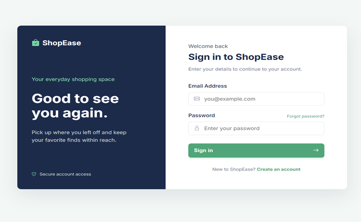
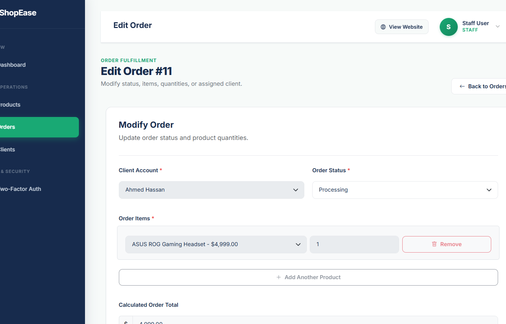
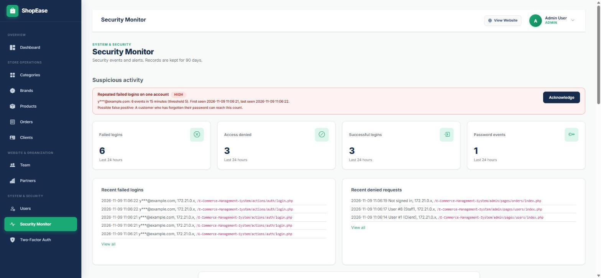

# ShopEase user manual

Use this guide to install ShopEase on Windows and try the customer and management portals.

[Installation](#1-set-up-the-web-server) · [Customer](#customer-user-guide) · [Staff](#staff-user-guide) · [Administrator](#administrator-user-guide) · [Account security](#account-security) · [Troubleshooting](#troubleshooting)

## 1. Set up the web server

Follow the [Windows setup guide for XAMPP](windows.md) to enable HTTPS on port `8443`.

## 2. Set up the database

1. Open **phpMyAdmin** from XAMPP. Use a database you can replace: the first import deletes and recreates the local `ecommerce` database.
2. On the server’s **Import** tab, import [`database/ecommerce.sql`](../../database/ecommerce.sql). Select `ecommerce` in the sidebar, then import [`database/migration_security_audit.sql`](../../database/migration_security_audit.sql).
3. In the ShopEase folder beside `index.php`, create a plain text file named `.env` (without `.txt`). Enter your local database settings. Use the MySQL port shown in the XAMPP Control Panel.

   ```dotenv
   DB_HOST=127.0.0.1
   DB_PORT=3306
   DB_NAME=ecommerce
   DB_USER=your_local_database_user
   DB_PASS=your_local_database_password
   ```

   XAMPP usually uses port `3306`. Leave the value after `DB_PASS=` empty only if your local database user has no password. Keep `.env` out of Git.

## 3. Open ShopEase

| Page | Address |
| --- | --- |
| Storefront | [https://localhost:8443/E-Commerce-Management-System/](https://localhost:8443/E-Commerce-Management-System/) |
| Customer sign-in | [Open customer sign-in](https://localhost:8443/E-Commerce-Management-System/pages/auth/login.php) |
| Staff or administrator sign-in | [Open management sign-in](https://localhost:8443/E-Commerce-Management-System/admin/login.php) |



## Try the demo

Use separate demo accounts for the three roles. If there is no administrator account on your own local demo database, register one through the storefront, sign out, then use phpMyAdmin to set that demo account’s role to `Admin` in the `users` table. Sign in to the management portal and use **Users** to create a Staff account.

### Customer user guide

- **Register or sign in.** On the customer sign-in page, choose **Create an account**. Enter your name, email, phone, city, address and password. ShopEase signs you in after registration. Returning customers use **Login** on the storefront.
- **Browse products.** Open **Products**, choose a category if needed and select an item to see its price, description and available stock. For the demo, try the Dell Inspiron 15.
- **Cart and checkout.** Choose a quantity and click **Add to Cart**. Use the cart icon to change quantities or remove an item. Click **Proceed to Checkout**, check the delivery details and click **Place order securely**. If stock changes, review the cart before trying again.
- **Orders.** Open **View my orders** from your profile or **Order History** in the footer. You can only see your own orders. To cancel a pending order within two hours of placing it, click **Cancel**, then **Yes, Cancel It**.
- **Profile.** Click your name at the top of the storefront. Update your name, phone, city or address and click **Save changes**. Your email is read-only. To set a new password, use **Change Password** and enter your current password.

### Staff user guide

- **Sign in.** Open the management sign-in page and use your Staff account. Enter your authenticator code if you have enabled two-factor authentication.
- **Products and stock.** Go to **Products → Add Product** or click the pencil icon on an existing product. Enter a whole stock quantity of zero or more. For a new product, enter a non-negative price with up to two decimal places, and upload a JPG, PNG, GIF or WebP image of 5 MB or less.
- **Orders.** Go to **Orders** and open **View order items** to check the order. Use **Edit order status** and **Save Changes** to update the status. Staff can only keep a shipped order as **Shipped** or move it to **Delivered**.
- **Clients.** Open **Clients** and select **View Client Details**. Staff cannot create, edit or delete customer records.
- **Restrictions.** Staff cannot change the price of an existing product or edit an order’s customer, items, quantities or total. Staff cannot create or delete orders, delete products, manage users or open **Security Monitor**.



### Administrator user guide

- **Users and roles.** Open **Users → Add User** or edit an existing user. Choose **Client**, **Staff** or **Admin** based on what the person needs to do. ShopEase prevents deleting the last Admin or changing that account’s role.
- **Products and orders.** Use **Products** to add, edit or delete products. Administrators can change the price of an existing product. In **Orders**, use **Create Order** or edit the customer, items, quantities and status on an existing order. Delivered and cancelled orders cannot change status. Shipped orders cannot be cancelled.
- **Audit logs.** Open **Security Monitor** in the sidebar. Under **Audit events**, choose an event type, outcome or date range, then click **Apply**. Use **Clear** to remove the filters.
- **Alerts.** Check **Suspicious activity** for alerts such as repeated failed logins. Review the related events, then click **Acknowledge**. Acknowledged alerts are removed from the open list.



[View the audit event filters and results](images/security-audit-events.png).

## Account security

- **Passwords.** Use at least eight characters, including an uppercase letter, a lowercase letter, a number and a symbol.
- **Temporary lockout.** ShopEase blocks sign-in after five failed attempts for one email or ten from one IP address within 15 minutes. If you are locked out, wait for the time shown before trying again.
- **Password reset.** Choose **Forgot password?** on the sign-in page and enter your registered email. Where email is configured, use the link to set a new password. The link expires after 30 minutes and works once. The default local setup does not send reset emails.
  For the local demo only, add `SHOPEASE_DEV_RESET_LINK=1` to `.env`. Request a reset for a registered email over `https://localhost:8443` to see the reset link on the **Forgot password?** page.
- **Two-factor authentication (MFA).** Staff and administrators can open **Two-Factor Auth** in the management portal. Scan the QR code with an authenticator app, enter the six-digit code and click **Verify Code & Enable MFA**. On your next sign-in, enter the current code after your password.
- **Recovery codes.** Save the eight backup codes somewhere private. If you cannot open your authenticator app, use one of these codes at the sign-in challenge. Each works once. Generating new codes invalidates the old ones.
- **Session timeout.** The customer and management portals require you to sign in again after 15 minutes of inactivity. Keep using the HTTPS address and log out when you finish on a shared computer.

The storefront footer links to **Account Security** and **Privacy Notice**.

## Troubleshooting

| Problem | What to check |
| --- | --- |
| Apache will not start or the site does not open | Run the Apache syntax check in [Windows setup](windows.md). Check the Include filename, confirm port `8443` is free, and use the full HTTPS address in [Open ShopEase](#3-open-shopease). |
| Browser warns about the certificate | Use `localhost`, not `127.0.0.1`, for ShopEase. Check that you trusted the certificate you generated and that it has not expired. Restart the browser after installing it. |
| Database connection failed | Start MySQL in XAMPP. Check the port, database name, username and password in `.env`. If you are setting up a fresh database, confirm you imported both SQL files in the order shown above. |
| Cannot sign in or reset the password | Use the correct portal for your role. Wait if the lockout message appears. The default local setup does not send reset emails; ask your demo administrator for help if needed. |
| Authenticator code is rejected | Check the phone’s automatic time setting and enter a fresh code. If you cannot access the app, use one unused recovery code. |
| Page says **403** or an action is missing | If the whole site is blocked, check that you used HTTPS. If a specific management page is blocked, check your role. For an expired form, open it again from the portal and retry after signing in if needed. |
| Product image or checkout is rejected | Check the image type and size or reduce the cart quantity to what is in stock. Use the message on the page to correct the entry. |
